Lab 4: Defend Against an Ongoing Attack
=======================================

**Scenario Lab 4**

In this lab, you will put your newfound Distributed Cloud security skills to test by defending 
against a persistent web-scraping attack. This lab is purposefully lean in screenshots and step by 
step directions as it requires you to use what you have learned for the shot at winning a gift card
if you are the first to mitigate the attack (for in-person AppWorld live event only).

The F5 web application is being targeted by a nefarious credential stuffing attack. Implement a 
blocking Bot defense policy on the login endpoint and verify that the endpoint is working for real
humans without adding any friction to the users.

**Expected Lab Time: 30 minutes**

Task 1: Place into Blocking Mode
~~~~~~~~~~~~~~~~~~~~~~~~~

For this exercise you will work on putting Bot Protection endpoint policy into blocking mode. You
will also customize a message for the Bot traffic mitigation response. Finally we will verify that
the policy is properly configured and mitigating the credential stuffing attack.

+----------------------------------------------------------------------------------------------+
|  1. Once you are confident your policy is detecting the scraper activity, place it into      |
|     blocking mode by going to your HTTP Loadbalancer --> Actions --> Manage Configuration    |
|     --> Edit Configuration --> Bot Protection then click Edit Configuration (Under Bot       | 
|     Defense Policy). Now under App Endpoint Type click Edit Configuration and finally click  |
|     three dots to the right of scraper-sec endpoint name then Edit. Make sure to Apply and   |
|     Save all changes.                                                                        |
+----------------------------------------------------------------------------------------------+
| |lab4-image01|                                                                               |
|                                                                                              |
| |lab4-image02|                                                                               |
|                                                                                              |
| |lab4-image03|                                                                               |
+----------------------------------------------------------------------------------------------+
|  2. Click on the three dots of the app endpoint created before and select Edit.              |
|                                                                                              |
+----------------------------------------------------------------------------------------------+
| |lab4-image04|                                                                               |
+----------------------------------------------------------------------------------------------+
|  3. Scroll down to the Bot Traffic Mitigation and change the action from Flag to Block       |
|     Additionally change the text in the response body to The requested URL was rejected by   |
|     F5 Bot Defense. Click on Apply > Apply > save HTTP-LB.                                   |
|                                                                                              |
+----------------------------------------------------------------------------------------------+
| |lab4-image05|                                                                               |
+----------------------------------------------------------------------------------------------+
|  3. Re-Run both Jobs human and basic from the RDP Jump Host desktop.                         |
|                                                                                              |
+----------------------------------------------------------------------------------------------+
|  **Basic Job:** No HITS this time, this means Bot Defense is doing its job.                  |
+----------------------------------------------------------------------------------------------+
| |lab4-image06|                                                                               |
+----------------------------------------------------------------------------------------------+
|  **Human Job:**  0 HITS again! - Even with valid credentials the requests are being blocked  |
|  when it comes from an automated attempt.                                                    |
+----------------------------------------------------------------------------------------------+
| |lab4-image07|                                                                               |
+----------------------------------------------------------------------------------------------+

Task 2: Verify NO added friction to humans using the website
~~~~~~~~~~~~~~~~~~~~~~~~~~~~~~~~~~~~~~~~~~~~~~~~~~~~~~~~~~~~

In this activity you will navigate to your application and enter valid credentials to verify you
are not being blocked. From the Jump Host, go to the provided FQDN. 

+----------------------------------------------------------------------------------------------+
|  1. Go to https://<your-namespace>.lab-sec.f5demos.com in you browser and use the account    |
|     below to sign in.                                                                        |
|                                                                                              |
|     * Username: john.smith                                                                   |
|     * Password" M@ster/Beetle                                                                |
+----------------------------------------------------------------------------------------------+
| |lab4-image08|                                                                               |
+----------------------------------------------------------------------------------------------+
|  2. You made it you are in! Bot defense is still working, and you were able to login without |
|     issues. Note that you are using the same computer to login than the one used by the      |
|     automation.                                                                              |
|                                                                                              |
|     Bot defense uses the signals collected on each individual request to block or allow      |
|     traffic.                                                                                 |
+----------------------------------------------------------------------------------------------+
|  |lab4-image09|                                                                              |
|                                                                                              |
+----------------------------------------------------------------------------------------------+

Task 3: Navigate through the Bot defense Dashboards
~~~~~~~~~~~~~~~~~~~~~~~~~~~~~~~~~~~~~~~~~~~~~~~~~~~

For this exercise you will go back to the Bot Defense dashboards and investigate the details of
the new blocked traffic and the human generated traffic.

+----------------------------------------------------------------------------------------------+
| 1. Return to the Bot Defense Workspace.                                                      |
+----------------------------------------------------------------------------------------------+
|  |lab4-image10|                                                                              |
+----------------------------------------------------------------------------------------------+
| 2. Now we have a new traffic type, “Human”                                                   |                                                                                             
+----------------------------------------------------------------------------------------------+
|  |lab4-image11|                                                                              |
+----------------------------------------------------------------------------------------------+
| 3. Go to the traffic analyzer to investigate further, add a filter to the dashboard to       |
|    remove the telemetry client from the traffic type. Create a filter with Method POST.      |
|                                                                                              |
+----------------------------------------------------------------------------------------------+
|  |lab4-image12|                                                                              |
+----------------------------------------------------------------------------------------------+
| 4. Notice Post requests coming from the same IP but some are Humans & some others are Bots.  |
|                                                                                              |
+----------------------------------------------------------------------------------------------+
|  |lab4-image13|                                                                              |
+----------------------------------------------------------------------------------------------+

Now we see traffic from Humans and traffic from bots, F5 bot defense is checking on each 
individual request and its signals to identify automation targeting your login endpoint, without
adding any friction to the users.

+----------------------------------------------------------------------------------------------+
| **End of Lab 4:**  This concludes Lab 4, feel free to review and test the configuration.     |
|                                                                                              |
|   Your logs show the proper endpoint and method, blocking bots and allowing Humans.          |
+----------------------------------------------------------------------------------------------+
| |labend|                                                                                     |
+----------------------------------------------------------------------------------------------+

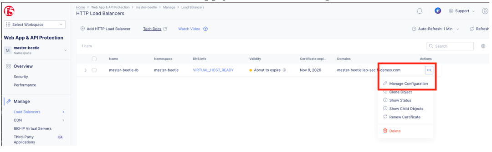
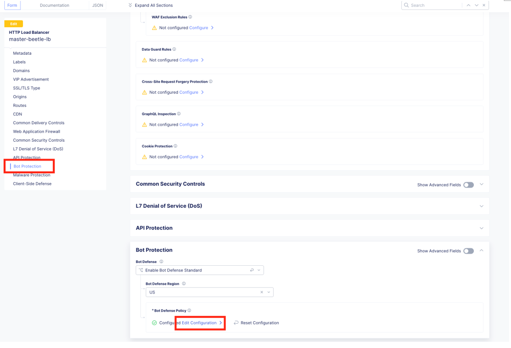
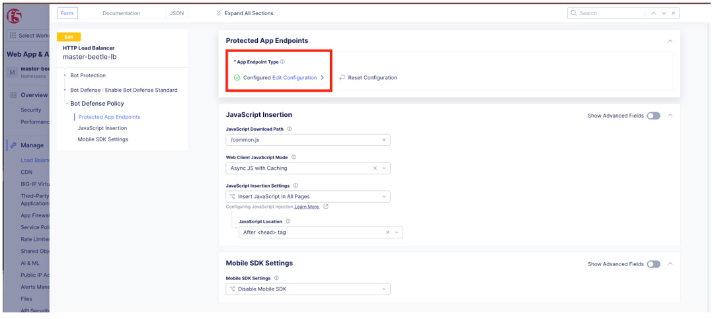
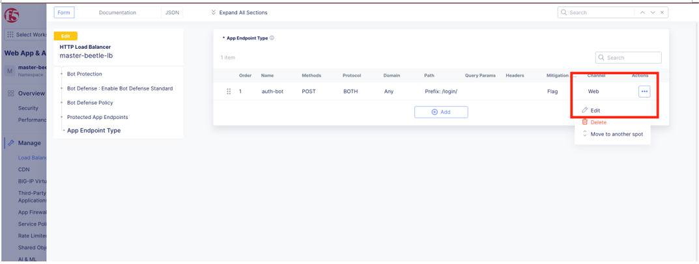
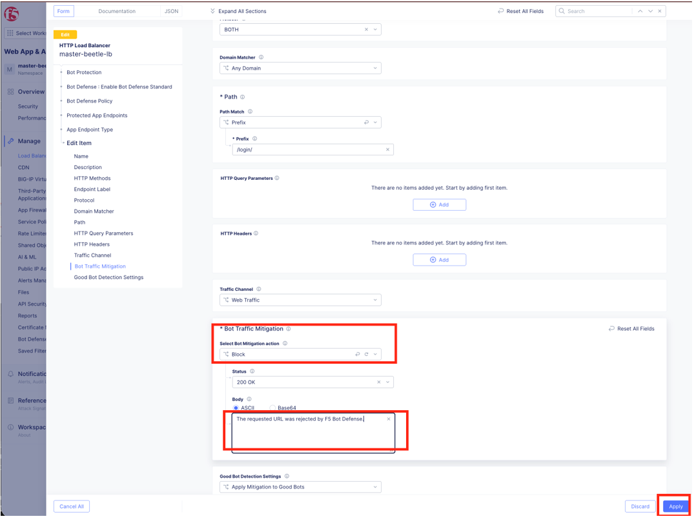
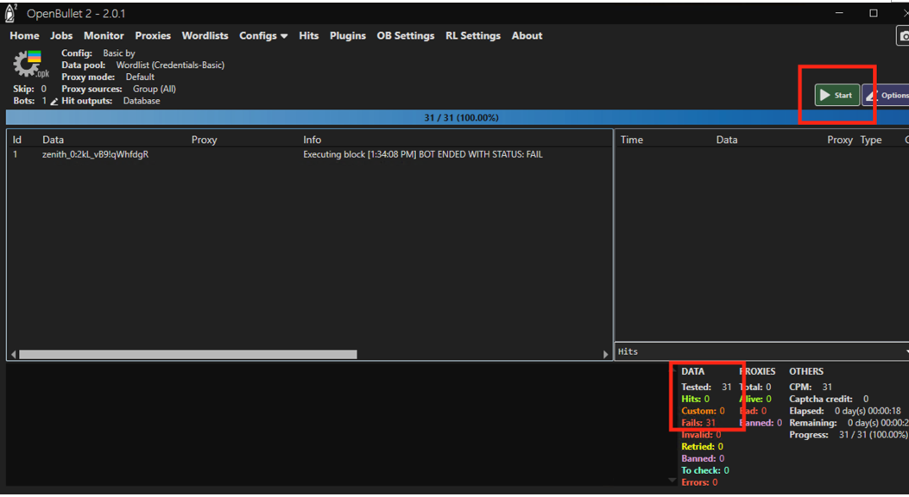
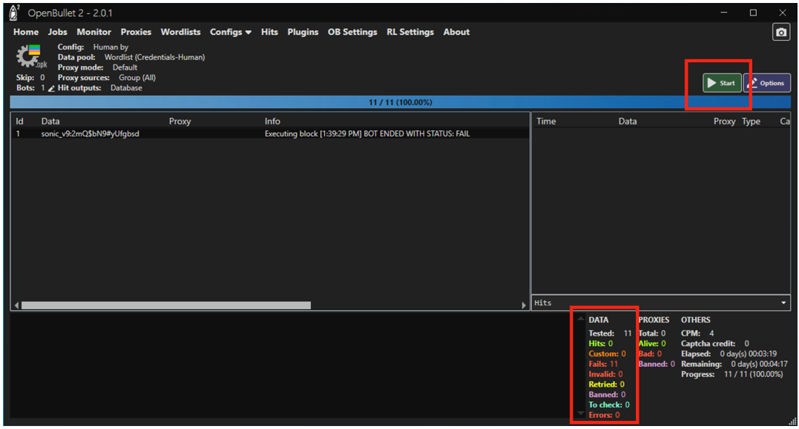
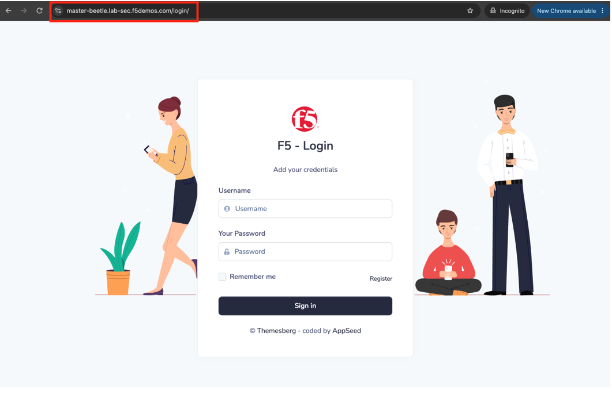
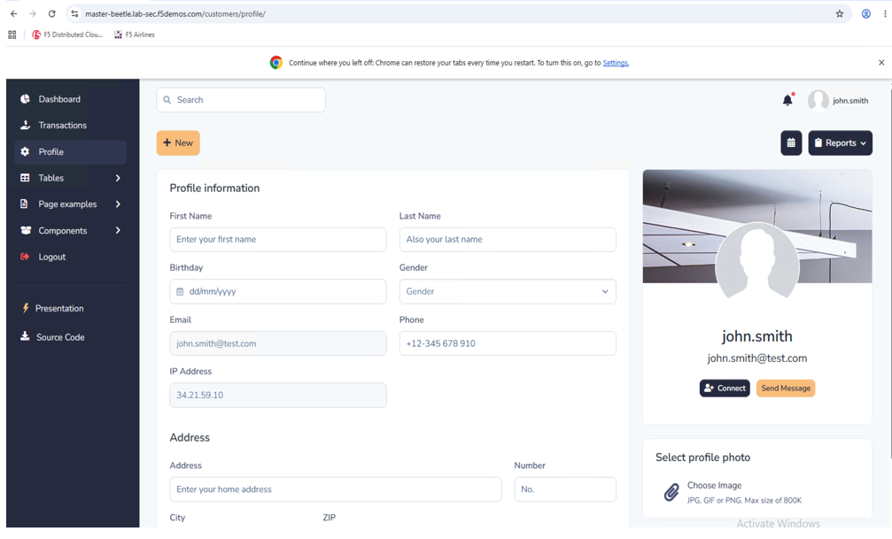
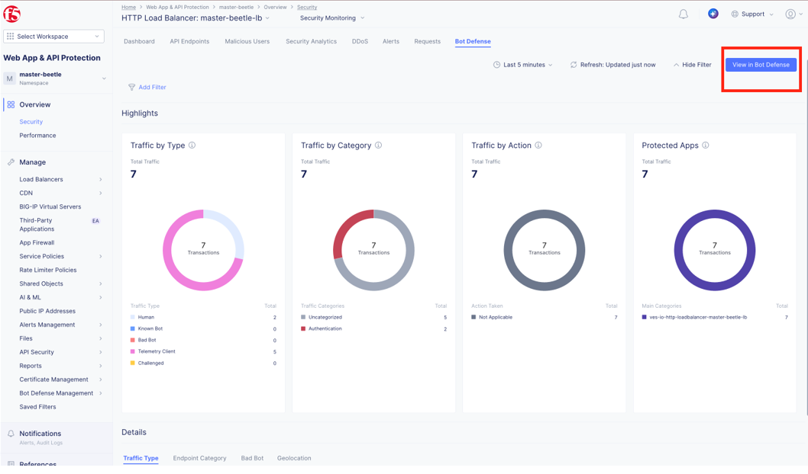
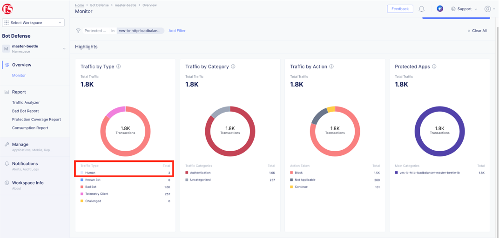
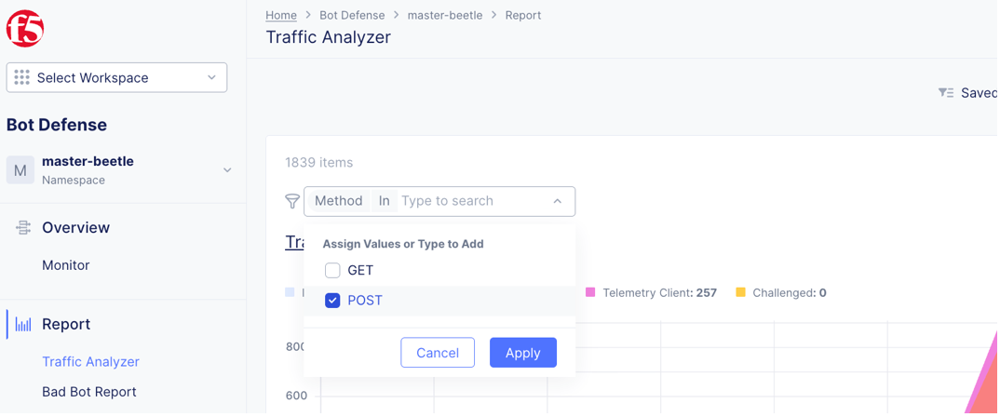
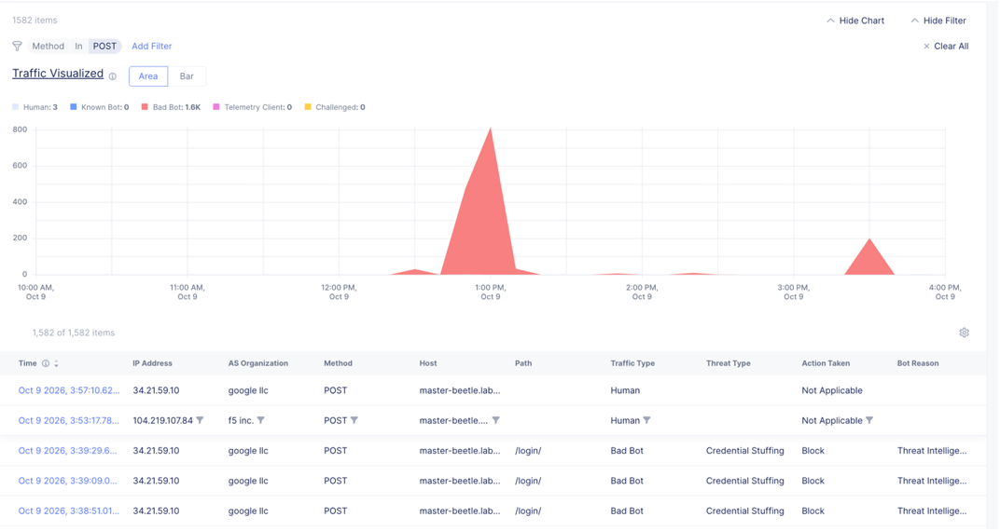
.. |labend| image:: _static/labend.png
   :width: 800px
      
